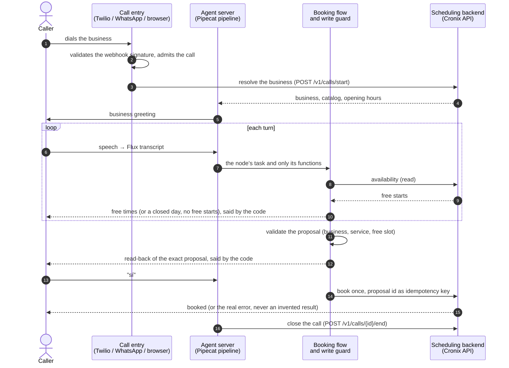
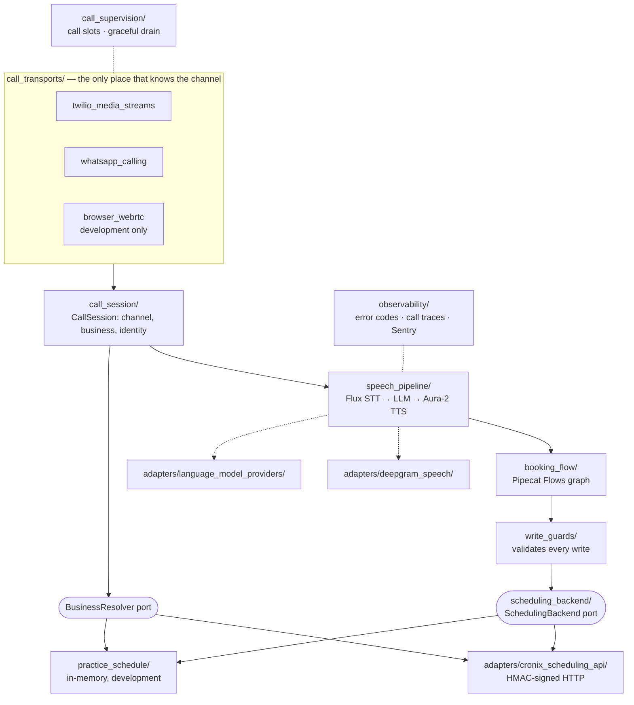

# Voice Call Agent

A real-time voice agent that answers a business's phone calls and books appointments by talking
with the caller, in Spanish. It runs one cascaded speech engine (speech-to-text → language model →
text-to-speech) on [Pipecat](https://docs.pipecat.ai) and serves two call entries: a **phone line**
(Twilio Media Streams) and **WhatsApp** (Cloud API Calling over WebRTC). Its first scheduling
backend is Cronix, reached through a signed HTTP contract.

The design rule behind every module: **the model understands and phrases; the code owns the facts
and every write.** The conversation is a Pipecat Flows graph, the free times and the read-back of a
booking are said by the code, and nothing is written until the caller confirms the exact proposal
they just heard.

| | |
|---|---|
| **v1** | Book an appointment by voice |
| **v1.1** | Check, reschedule and cancel appointments |
| **Stack** | Python 3.12 · FastAPI · Pipecat 1.14.0 · Deepgram Flux and Aura-2 · `deepseek-v4.1-flash` through OpenRouter |
| **Status** | Phases 1 and 2 done in code; phase 0 waits for a Venezuelan phone number ([status](#status)) |

## Contents

1. [Status](#status)
2. [How a call works](#how-a-call-works)
3. [Architecture](#architecture)
4. [External services](#external-services)
5. [Running it locally](#running-it-locally)
6. [Project structure](#project-structure)
7. [Observability](#observability)
8. [Evals](#evals)
9. [Security](#security)
10. [Operations](#operations)
11. [Measured results](#measured-results)
12. [Quality gate and contributing](#quality-gate-and-contributing)
13. [Documentation map](#documentation-map)

## Status

| Area | State |
|---|---|
| Booking by voice | Works against the in-memory practice schedule and against a local Cronix through its signed API |
| Phone line (Twilio) | Built and tested; waiting for a Venezuelan number to take real calls |
| WhatsApp | Built and tested; **paused** until Meta enables *Calling* on the number (it requires a messaging limit of at least 2,000 daily recipients) |
| Browser practice entry | Development only: talk to the agent from this machine's microphone |
| Latency | Above the 1.0 s p50 target on practice calls (p50 1.71 s); being lowered step by step |

The current phase, what works and the next step are kept in
[manifest §12](docs/specs/call-module/manifest.md#12-status); the ordered plan is in
[`docs/specs/cronix-connection/tasks.md`](docs/specs/cronix-connection/tasks.md) ("Plan from
here").

## How a call works



1. **Entry.** The transport validates the provider's signature, rejects repeated or stale events and
   admits the call against the instance's concurrency limit.
2. **Business.** On the phone line each business has its own number, so the dialed number
   identifies it before the greeting. WhatsApp's number is shared, so the business comes from the
   caller's session or client record, and the agent asks when it cannot be decided.
3. **Conversation.** A Pipecat Flows graph (ADR 0019): request → which day (when a weekday and a
   date disagree) → choose a time → name → confirm → booked or not booked. Each node gives the
   model one task and only its functions; the code moves on each function's result.
4. **Write.** The write guard validates the proposal against the backend's catalog and the
   availability read at that moment. The booking runs only after a caller turn that followed the
   read-back, once per intent (ADR 0011).

## Architecture



| Principle | What it means in the code |
|---|---|
| **Ports and adapters** | The domain depends on the `SchedulingBackend` and `BusinessResolver` protocols. "Cronix" appears only in `adapters/cronix_scheduling_api/` and the composition root. |
| **Isolated channel** | From the pipeline inwards, "Twilio", "WhatsApp" and "browser" do not exist: only `session.business_id` and `session.identity_verified`. An architecture test enforces it. |
| **Cascaded, not speech-to-speech** | Separate STT, LLM and TTS keep each turn's text and tool calls auditable before anything is written (ADR 0003). |
| **Pipecat first** | Pipecat's Flows, turn strategies, latency breakdown and observers come before own code (ADR 0019). |
| **Composition root** | `service_composition.py` wires every dependency; no global singletons, no import-time side effects. |
| **Fixed tenant** | Once resolved, a call's business never changes; the business never comes from what the model says. |

The full architecture, invariants (INV-1 to INV-8) and latency budget are in the
[manifest](docs/specs/call-module/manifest.md).

## External services

| Service | Used for | Configured with | Needed for |
|---|---|---|---|
| **Deepgram** | Flux speech-to-text (`flux-general-multi`) and Aura-2 text-to-speech (`aura-2-selena-es`) | `DEEPGRAM_API_KEY`, `STT_*`, `TTS_VOICE` | Every call |
| **OpenRouter** | The language model `deepseek/deepseek-v4.1-flash`, routed to Together and, when Together fails, to Venice (ADR 0020); also the judge of the model evals | `LLM_PROVIDER=openrouter`, `OPENROUTER_API_KEY` | Every call (default provider) |
| Groq, Google, OpenAI | Alternative language model providers, used to measure candidates | `LLM_PROVIDER`, `LLM_MODEL` and the provider's key | Optional |
| **Cronix** | Scheduling backend: business resolution, availability, booking, end of call ([contract](docs/specs/cronix-phone-api-contract.md)) | `SCHEDULING_BACKEND=api`, `SCHEDULING_API_URL`, `SCHEDULING_API_SIGNING_SECRET` | Real bookings |
| **Twilio** | Phone-line entry (Media Streams) | `PUBLIC_BASE_URL`, `TWILIO_ACCOUNT_SID`, `TWILIO_AUTH_TOKEN` | Phone calls |
| **Meta WhatsApp Cloud API** | WhatsApp Calling entry (WebRTC) | `WHATSAPP_*` (all four or none) | WhatsApp calls (paused) |
| **Sentry** | Error tracking, one transaction per call, metrics and alerts | `SENTRY_DSN` | Optional; recommended in production |

An entry is mounted only when its whole group of variables is set; a partially filled group stops
the service at startup. Every variable is documented in [`.env.example`](.env.example).

## Running it locally

### Requirements

- Python 3.12 and [uv](https://docs.astral.sh/uv/)
- A Deepgram key and an OpenRouter key (the only paid services a practice call uses)
- Optional: a local Cronix (Supabase CLI) to book through the real API

### 1. Install

```bash
uv sync
uv run pre-commit install     # ruff and gitleaks on every commit
cp .env.example .env          # then fill in the keys
```

### 2. Talk to the agent from the browser (practice entry)

The fastest way to try the whole engine, with no phone number (ADR 0015). In `.env`:

```bash
ENVIRONMENT=development
BROWSER_PRACTICE_ENABLED=true
SCHEDULING_BACKEND=practice
LOG_FORMAT=text
CONVERSATION_TRANSCRIPTS_DIR=var/conversation_transcripts
LOG_FILE_PATH=var/service.log
```

```bash
uv run voice-call-agent       # then open http://localhost:8000/practice
```

Pick a business on the page, allow the microphone and ask for an appointment. Use headphones to
try interrupting the agent.

| Setting | Effect |
|---|---|
| `SCHEDULING_BACKEND=practice` | Fictitious businesses kept in memory and lost on restart: a barbershop, a dental clinic (prices in bolívares) and a spa ([`practice_businesses.toml`](src/voice_call_agent/practice_schedule/practice_businesses.toml)). Each has a fictitious number; the call reaches the business whose line you pick, as a phone call reaches the number it dials (ADR 0017). |
| `CONVERSATION_TRANSCRIPTS_DIR` | One text file per call: the prompt the model received, what was said and each tool call with its result. |
| `LOG_FILE_PATH` | A `DEBUG` copy of the log: flow transitions and what the model received on each turn. |

The practice entry, the practice schedule, transcripts and the log file are **refused outside
`ENVIRONMENT=development`**, and the practice page answers only a browser on the same machine.
Its latency is not a phone call's: the browser's audio is wideband and never leaves the machine.

### 3. Book in a local Cronix

With Cronix's local Supabase running and its `phone-agent-api` function served with a test
signing secret:

```bash
SCHEDULING_BACKEND=api \
SCHEDULING_API_URL=http://127.0.0.1:54321/functions/v1/phone-agent-api \
SCHEDULING_API_SIGNING_SECRET=<the same test secret> \
PRACTICE_LINES="+13055550101=Barbería Local;+13055550102=Clínica Dental Local" \
uv run voice-call-agent
```

`PRACTICE_LINES` lists the lines the practice page offers, each a line of a business in that
Cronix. Only fictitious numbers (555-0100 to 555-0199) are accepted, so the page never dials a
real business.

### 4. Phone line (Twilio)

1. Expose the port with a tunnel (`ngrok http 8000` or cloudflared) and set `PUBLIC_BASE_URL` to
   that URL. **Keep the practice entry off while the port is exposed.**
2. Set the Twilio group in `.env`.
3. On the business's number, *A call comes in* → Webhook `POST {PUBLIC_BASE_URL}/twilio/voice`.
4. Call it. The webhook validates `X-Twilio-Signature`, answers `<Connect><Stream>` with an
   admission token, and the audio arrives over `wss://…/twilio/stream`.

### 5. WhatsApp (paused)

With the `WHATSAPP_*` group empty the entry is not mounted. To resume it:

1. In the Meta app, set the webhook to `{PUBLIC_BASE_URL}/whatsapp/webhook` with
   `WHATSAPP_VERIFY_TOKEN`.
2. Subscribe the **`calls`** field and enable *Calling* on the number (or use a Meta test number).
3. Call from the chat's call icon. The server validates `X-Hub-Signature-256`, accepts the call
   and negotiates WebRTC.

### After a call

| Where | What it shows |
|---|---|
| `var/call_traces.jsonl` | One JSON line per call: latency per turn and segment, cost, backend requests, write decisions, errors |
| `var/conversation_transcripts/` | What was said, as heard and as spoken (development only) |
| `var/service.log` | The full log, flow transitions included (development only) |

## Project structure

```text
.
├── src/voice_call_agent/          # the service (the only shipped package)
│   ├── __main__.py                # process entry: `uv run voice-call-agent`
│   ├── service_composition.py     # composition root: wires every dependency from settings
│   ├── asgi_app.py                # FastAPI app: mounts the enabled entries and health routes
│   ├── graceful_http_server.py    # uvicorn with a graceful drain on shutdown
│   ├── call_transports/           # the call entries; the only code that knows the channel
│   │   ├── twilio_media_streams/  #   phone line: signed webhook, TwiML, Media Stream, hang-up
│   │   ├── whatsapp_calling/      #   WhatsApp: signed webhook, accept/reject, WebRTC session
│   │   ├── browser_webrtc/        #   development practice page and its WebRTC offer
│   │   └── replay_guard.py        #   rejects repeated webhook events
│   ├── call_session/              # CallSession: channel, business, caller phone, identity
│   ├── call_supervision/          # call slots per instance, concurrency limit, drain
│   ├── speech_pipeline/           # the Pipecat pipeline and what each call says and can do
│   ├── booking_flow/              # the booking conversation as a Pipecat Flows graph
│   ├── write_guards/              # validates every write proposal and its confirmation
│   ├── scheduling_backend/        # the SchedulingBackend port, its models and errors
│   ├── practice_schedule/         # in-memory backend with fictitious businesses (development)
│   ├── adapters/                  # implementations of the ports and provider factories
│   │   ├── cronix_scheduling_api/ #   the only code that knows Cronix: signed HTTP, idempotency
│   │   ├── deepgram_speech/       #   Flux STT and Aura-2 TTS
│   │   └── language_model_providers/  # OpenRouter (default), Groq, Google, OpenAI
│   ├── conversation_content/es/   # Spanish prompts and phrases the caller hears (resource files)
│   ├── observability/             # error taxonomy, call traces, latency, cost, Sentry, redaction
│   ├── http_hardening/            # security headers, rate limits, error responses
│   └── settings/                  # typed configuration from environment variables
├── evals/                         # quality measurement (not shipped)
│   ├── golden_dataset/            #   one YAML per golden case
│   ├── conversation_harness/      #   scripted model and speech over a loopback transport
│   ├── model_evals.py             #   real model plus a judge, against the baseline
│   ├── baseline.json              #   the stored measurements and behaviour fingerprint
│   └── text_to_speech_comparison/ #   voice comparison with phone-quality samples
├── tests/
│   ├── unit/                      # one folder per source module
│   ├── integration/               # the HTTP surface, the app and each entry end to end
│   ├── evals/                     # reference conversations, golden dataset and harness tests
│   ├── snapshots/                 # what shapes behaviour: prompts, phrases, flow, tools (syrupy)
│   └── architecture/              # naming, size limits, channel isolation, tenant boundary
├── docs/                          # specs, ADRs, threat model, alerts, golden dataset
├── .github/workflows/             # CI, model evals, provider reachability, TTS comparison
└── var/                           # local output: call traces, transcripts, eval reports (git-ignored)
```

Every module has one responsibility, described in the
[manifest's component table](docs/specs/call-module/manifest.md#components).

## Observability

A failure is found in the observability first; what it cannot show is instrumented before it is
fixed (constitution §16).

| Signal | What it holds | Where |
|---|---|---|
| **Error codes** | Every error has a code and a kind (real failure or expected outcome), defined in `observability/error_taxonomy.py` and reported through `report_error` | Structured JSON logs; Sentry issues for real failures |
| **Call trace** | One per call: prompt and model versions, latency per turn and per segment (from Pipecat's latency breakdown), provider usage, estimated cost, which upstream served each model response, write decisions and the duration of each backend request | `var/call_traces.jsonl` (`CALL_TRACE_LOG_PATH`); a Sentry transaction per call |
| **Backend timing** | Each scheduling request: operation, start, duration, outcome | The trace's `backend_requests`; Sentry `scheduling.request` spans and the `voice.scheduling.request` metric |
| **Event loop stalls** | Where the loop was blocked | `EVENT_LOOP_STALLED` error code |
| **Alerts** | Production monitors | [`docs/observability/alerts.md`](docs/observability/alerts.md) |
| **Transcripts and debug log** | What was said and what the model received (development only) | `CONVERSATION_TRANSCRIPTS_DIR`, `LOG_FILE_PATH` |

Personal data is redacted from traces and logs. Keep `LOG_LEVEL` at `INFO` or higher in
production: Pipecat logs conversation content at `DEBUG`.

p50/p95 latency per channel against the budget of manifest §6:

```bash
uv run python -m voice_call_agent.observability.latency_budget_report var/call_traces.jsonl
```

## Evals

One golden dataset ([`evals/golden_dataset/`](evals/golden_dataset/)), measured at two levels
(ADR 0010):

| Level | What it runs | Cost | When |
|---|---|---|---|
| **Reference conversations** | Every golden case through the real pipeline and flow, with a scripted model and scripted speech over a loopback transport; checks what each call wrote | Free, no provider is called | Every change, in CI |
| **Model evals** | The real model on every case, three repetitions, scored by a judge model that reads the prompt and every tool result, against the stored baseline | About 0.40 USD per run | When the behaviour fingerprint changes |

```bash
uv run pytest tests/evals tests/snapshots                         # reference conversations, snapshots
uv run --env-file .env --group evals python -m evals.model_evals  # real model + judge vs the baseline
```

- **Security measures never drop.** `invents-nothing`, `no-unwanted-write`, `books-what-was-asked`
  and `asks-which-day` must stay at 1.00. A quality measure may drop only within its margin
  measured from noise (ADR 0016), or with a stored reason (`--accept-drop`).
- **Behaviour fingerprint.** A change to the prompt, phrases, model, practice businesses or scoring
  changes the fingerprint (ADR 0013), and the model evals must store a new baseline:
  `--write-baseline` locally, or from a GitHub-hosted runner with
  `gh workflow run evals.yml --ref <branch> -f write_baseline=true`.
- **Any catalog.** Booking cases run against every practice business, each a different kind of
  business, so the agent is shown working for any catalog, not for one.

Text-to-speech voices are compared on the "first token → first audio" segment, with phone-quality
samples to choose by ear:

```bash
uv run --env-file .env python -m evals.text_to_speech_comparison  # report and samples in var/
```

Details: [golden dataset](docs/evals/golden-dataset.md).

## Security

| Control | Detail |
|---|---|
| Webhook signatures | Twilio and Meta signatures validated in constant time over the raw body; repeated and stale events rejected |
| Call admission | One Media Stream per call, behind an admission token |
| Writes | Validated by code against the backend; executed only after the caller confirms the read-back, once (ADR 0011) |
| Tenancy | The business comes only from the `CallSession`; tenant isolation tests |
| Identity | The phone line's caller ID can be spoofed: reading, rescheduling or cancelling there needs a second factor (v1.1); callers are greeted by name only on WhatsApp |
| HTTP | Security headers on every response, no `Server` header, CORS closed, trusted hosts, no API docs in production, error responses that reveal nothing |
| Limits | Rate limits per client address and route; request bodies and WebSocket messages capped at 64 KiB |
| Secrets | Environment variables only, loaded as `SecretStr`; never in code, logs or errors; gitleaks on every commit |
| Development surfaces | The practice entry, practice schedule, transcripts and log file are refused outside development |

Behind a proxy, set `TRUSTED_PROXY_ADDRESSES` and `ALLOWED_HOSTS`; with several instances, a
shared `RATE_LIMIT_STORAGE_URI`. Threats and accepted risks:
[threat model](docs/security/threat-model.md).

## Operations

| Endpoint or behaviour | Meaning |
|---|---|
| `GET /health/live` | The process is up |
| `GET /health/ready` | `503` while draining or at `MAX_CONCURRENT_CALLS` |
| SIGTERM / SIGINT | Stops accepting calls and waits up to `SHUTDOWN_GRACE_SECONDS` for the calls in progress; a second signal shuts down at once. Give the orchestrator a longer termination grace period. |
| Logs | Structured JSON on stderr (`LOG_FORMAT=text` for development) |

The production server will run in São Paulo, near the scheduling backend's database (manifest §11);
the provider is not chosen yet.

## Measured results

Each figure states its date and what it was measured with; what is not measured yet says so.

| What | Result | Measured with |
|---|---|---|
| Language model, time to the first token (on a call the segment of manifest §6 also includes turn detection) | `deepseek/deepseek-v4.1-flash` on Together, reasoning effort `low`: p50 391 ms, p90 665 ms (176 responses of the model evals, 2026-10-28, ADR 0020). Earlier, Groq `openai/gpt-oss-120b` with reasoning effort `low`: p50 375 ms, p95 571 ms. With Groq's default effort: 544 / 976 ms. DeepSeek `deepseek-flash`, thinking off: 776 / 937 ms | 2026-10-19; 20 streamed answers per configuration to five caller turns with fictitious data; conversation content `es-c3d0810115bd`; from a GitHub-hosted runner (pull request #3, closed without merging) |
| Latency per segment and channel on real calls | Not measured yet on real calls. Practice calls (browser entry, local Cronix, development machine): per turn p50 / p90 speech-to-text 581 / 956 ms, language model 778 / 1,664 ms, text-to-speech 252 / 276 ms (turns where the model spoke), total 1,711 / 2,614 ms, above the 1.0 s p50 target | 2026-10-31; 29 turns of three practice calls; call traces (`var/call_traces.jsonl`); `docs/specs/cronix-connection/tasks.md` D4 holds the plan to lower it |
| Speech-to-text on phone audio | Not measured: it needs real phone-line calls, blocked until the line has a Venezuelan number | |
| Golden dataset success (model level, baseline) | `invents-nothing`, `no-unwanted-write`, `books-what-was-asked` and `asks-which-day` 1.00 (security), `bookings-completed`, `confirms-after-the-answer`, `natural-spanish`, `admits-test-line` and `speakable-replies` 1.00, `brief-replies` 0.90 (within its margin; the model's goodbyes) | 2026-11-11; 25 cases, including two services in one call, booked one after the other, 3 repetitions; `deepseek/deepseek-v4.1-flash` at low reasoning effort through OpenRouter (Together), judge `google/gemini-3.6-flash`; measured locally with the service's defaults. The day is worked out by the code from the caller's words, and the free times, the question for the name, which day when a weekday and a date disagree, a closed day, a day without free starts, a time taken before the confirmation, a backend that does not answer, the read-back and the booking done are said by the code. In that run the model under test cost an estimated 0.174 USD and took p50 912 ms, p90 2,066 ms per turn, three conversations at a time (not a call's latency) |
| Reasoning off | Not adopted: the security measures held at 1.00 in three runs, but the model asked for a name, a time or a surname the caller had already given, and `bookings-completed` ranged from 0.89 to 1.00 | 2026-11-10; three model evals runs, same cases and judge (manifest §10) |
| Cost per call | Practice calls of about two minutes, booked: 0.056 to 0.062 USD estimated (model, speech-to-text and text-to-speech; no telephony) | 2026-10-31; three call traces, price table `2026-10-28.1` |
| Capacity per instance | Not measured: it needs a load test on the production server, which is not contracted yet (phase 4) | |

## Quality gate and contributing

Before every commit and push, run the same hooks CI runs. `.pre-commit-config.yaml` is their only
list (ADR 0008): ruff, `mypy --strict`, the test suite, bandit, pip-audit, gitleaks and
actionlint.

```bash
uv run pre-commit run --all-files --hook-stage manual
git status    # no .env, token, key or credential file staged
```

- Changes reach `main` only through a pull request whose required checks are green; a maintainer
  approves the merge (ADR 0012).
- Documentation is part of every change: this README, the manifest, the specs and the ADRs.
  The README always describes the current state: every accepted change updates the sections it
  affects, and the pull request ([template](.github/pull_request_template.md)) lists them or
  says why none changed (constitution §8).
- A change to the prompt, phrases, model, generation settings or tools needs the model evals
  against the baseline.
- A changed snapshot is reviewed and regenerated with
  `uv run pytest tests/snapshots --snapshot-update`.

| Workflow | Runs |
|---|---|
| `ci.yml` | The quality gate on every push and pull request (required checks) |
| `evals.yml` | The model evals when the behaviour fingerprint changes, and on demand (needs the `OPENROUTER_API_KEY` secret); not required, but a pull request is not merged with it failing |
| `provider-reachability.yml` | On demand: checks the runners reach every provider |
| `text-to-speech-comparison.yml` | The voice comparison on demand and when it changes (needs the `DEEPGRAM_API_KEY` secret) |

Read [`CLAUDE.md`](CLAUDE.md) and the [constitution](docs/specs/constitution.md) before writing
code: they hold the non-negotiable rules on language, naming, typing, secrets and scope.

## Documentation map

| Document | Read it for |
|---|---|
| [Constitution](docs/specs/constitution.md) | The non-negotiable rules |
| [Manifest](docs/specs/call-module/manifest.md) | Scope, architecture, invariants, latency budget, phases, risks and status |
| [Cronix contract](docs/specs/cronix-phone-api-contract.md) | The signed HTTP API between the agent and the scheduling backend |
| [Cronix connection tasks](docs/specs/cronix-connection/tasks.md) | What was built, what was measured and the plan from here |
| [Architecture decisions](docs/adr/README.md) | Every decision taken, with its reasons |
| [Threat model](docs/security/threat-model.md) | Threats, controls and accepted risks |
| [Golden dataset](docs/evals/golden-dataset.md) | The eval cases, measures and margins |
| [Alerts](docs/observability/alerts.md) | Production monitors |
